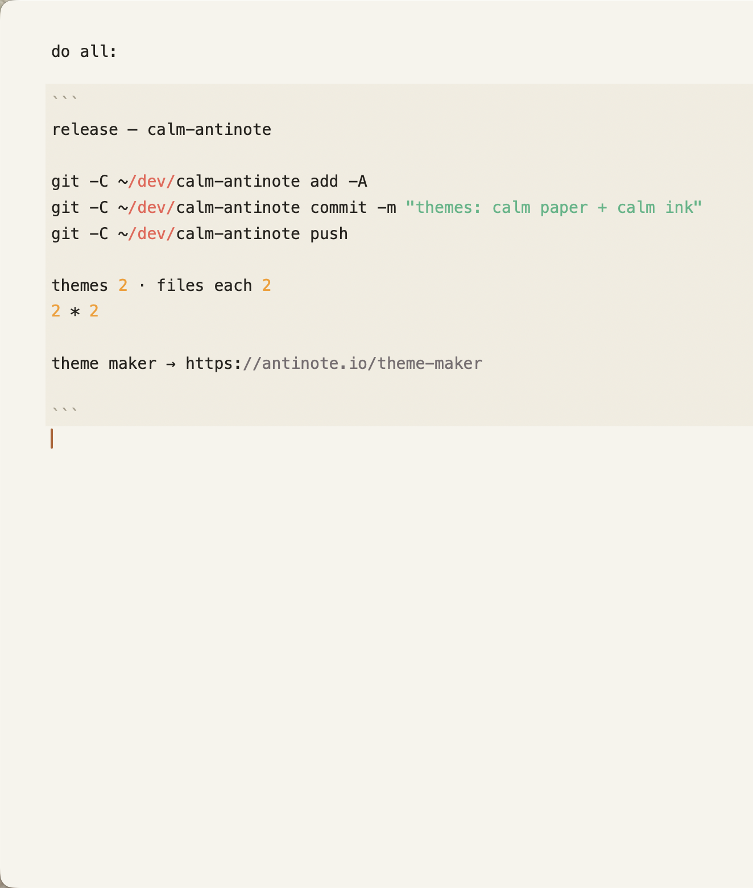
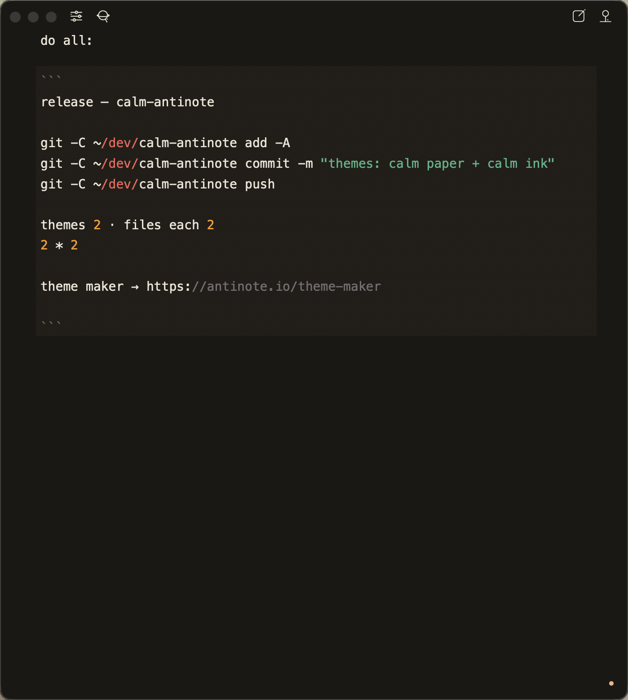

```
          ··················∙∙∙∙∙·········
        ··········∙∙∙∙∙∙∙∙∙∙∙∙∙∙∙∙∙∙∙∙······
      ·······∙∙∙∙∙∙∙∙∙∙∙∙∙∙∙∙∙∙∙∙∙∙∙∙∙∙······
     ······∙∙∙∙∙∙∙∙∙∙∙∙∙•••••••••••∙∙∙∙∙∙····
    ·····∙∙∙∙∙∙∙∙••••••••••••••••••••∙∙∙∙·····
    ····∙∙∙∙∙∙•••••••••••••••••••••••∙∙∙∙∙····
   ·····∙∙∙∙∙∙•••••••••••••••        ∙∙∙∙∙····
   ·····∙∙∙∙∙∙•••••••••••••••  calm  ∙∙∙∙∙····
    ····∙∙∙∙∙∙∙∙∙∙∙∙∙∙∙∙∙∙•••  ────  ∙∙∙∙·····
    ·····∙∙∙∙∙∙∙∙∙∙∙∙∙∙∙∙∙∙∙∙        ∙∙∙·····
     ······∙∙∙∙∙∙∙∙∙∙∙∙∙∙∙∙∙∙∙∙∙∙∙∙∙∙∙∙·····
      ························∙∙∙∙∙∙·······
        ··································
           ·····························
```

# calm-antinote

Two calm themes for [Antinote](https://antinote.io) — a light one, **Calm Paper**, and a dark one,
**Calm Ink**. Warm paper, near-black ink, one clay accent, nothing louder.

## Why these exist (the honest version)

Antinote is already calm. Its built-in **Totoro** (light) and **A24** (dark) are the muted, un-shouty
ones in the set — sage-and-paper, cinematic slate-and-ochre, no neon. If you just want a calm Antinote,
pick those two and you're done. You don't need this repo.

These themes exist for one narrower reason: they mirror a **calm terminal palette** hex-for-hex, so a
note window and the terminal read as a single continuous surface. I use Antinote as a companion to the
terminal — a scratchpad to draft commands and instructions, then paste them across. When the note and the
shell share the exact same warm-paper ground, the same ink, and the same one accent, moving between them
stops feeling like moving between two apps.

So the difference from Totoro/A24 is deliberate and small: not "calmer", just **matched** — part of a
wider calm suite where consistency is the point and the subtle differences are what make it feel of a
piece. If you don't live half in a terminal, the built-ins will serve you just as well.

## The themes

Monochrome ink-on-paper. A single clay accent is the only colour — used sparingly, never alarm-red.

**Calm Paper** (light)
- ground `#F7F4EC` · ink `#26231E` · accent `#B5612F`

**Calm Ink** (dark)
- ground `#1B1814` · ink `#ECE6D8` · accent `#EDB489`

## Preview

| Calm Paper | Calm Ink |
| --- | --- |
|  |  |

A note in honesty: the previews show a fenced code block, and the red/green/orange in it is Antinote's
own syntax highlighting (via the bundled Highlightr) — not the theme. Those code colours aren't
theme-controlled, so a code block won't be fully monochrome. Everything else — prose, ink, links, and
the clay accent on numbers — follows the calm palette.

## Install

1. In Antinote, open **Settings → Visuals → Custom Themes → Open Folder** (or drop the files at
   `~/Library/Containers/com.chabomakers.Antinote/Data/Documents/Themes/`).
2. Copy `Calm/calm-paper.json` and `Calm/calm-ink.json` into that folder.
3. Back in Antinote, click **Reload Custom Themes**.
4. Pick **Calm Paper** as your light theme and **Calm Ink** as your dark theme (Antinote sets the two
   separately).

For the fullest calm, in **Visuals** also set: Paper Type **Blank**, Paper Type Opacity **Subtle**,
translucency **off**. Quiet ground, no pattern, solid page.

## On Linux

Antinote is macOS only.
On Linux, [Whisp](https://github.com/tanaybhomia/Whisp) is the closest match,
and the same palette for it lives in [`Whisp/`](Whisp/README.md).

## Submitting to the community themes

The [antinote-extensions](https://github.com/johnsonfung/antinote-extensions) repo collects community
themes under `themes-community/`, one folder per theme. To submit these: copy the `Calm/` folder into
`themes-community/Calm/` there and open a pull request. The folder already follows their convention — a
short README plus the theme JSON files.

## Credit

Part of the [calm](https://github.com/shakilclark/calm) suite. The palette comes straight from calm's
design tokens and its `calm-paper` / `calm-ink` terminal themes — that shared source is the whole reason
these match the terminal. Banner made with calm's `drift` ASCII engine.
